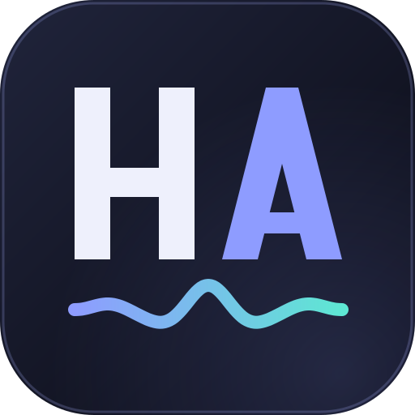
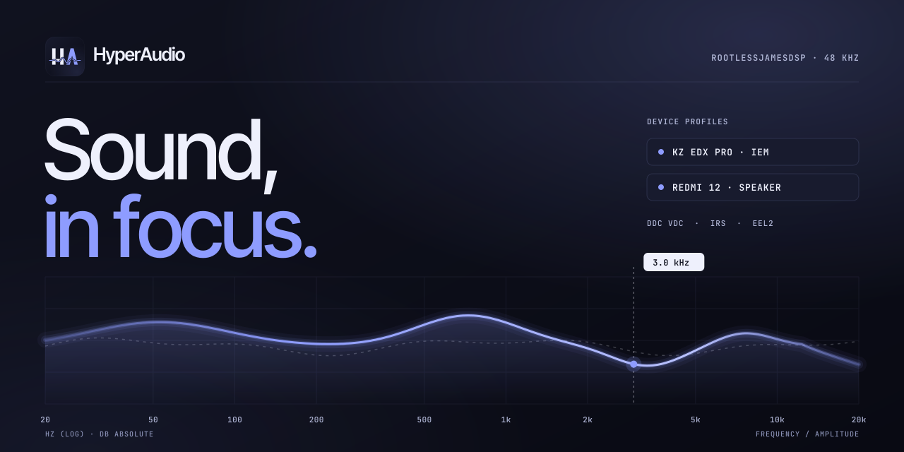
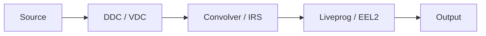

<div align="center">



# HyperAudio

**Sound, in focus.**  
Measurement-led DSP profiles for RootlessJamesDSP.

[](https://nmstudioo.github.io/Hyperaudio_v2/)


[Profiles](#established-profiles) · [Architecture](#processing-architecture) · [Quick start](#quick-start) · [Asset library](#asset-library) · [Browser tools](#browser-tools) · [Documentation](#documentation)



</div>

---

## Overview

HyperAudio publishes two established, device-specific three-file profiles. The current IEM export uses **KZ EDX Pro v5-HD**; the current Speaker export uses **Redmi 12 V6**. Historical releases and experimental variants are retained in a normalized asset library.

## Established profiles

| Device | Release | VDC | IRS | EEL2 |
|---|---|---|---|---|
| KZ EDX Pro | v5-HD | `profiles/iem/kz-edx-pro/v5-hd/edx-hd-core.vdc` | `profiles/iem/kz-edx-pro/v5-hd/edx-hd-core.irs` | `profiles/iem/kz-edx-pro/v5-hd/edx-ultra.eel` |
| Redmi 12 Speaker | V6 | `profiles/speaker/redmi-12/v6/ha-spk-v6.vdc` | `profiles/speaker/redmi-12/v6/ha-spk-v6.irs` | `profiles/speaker/redmi-12/v6/ha-spk-v6.eel` |

### KZ EDX Pro · v5-HD

- IRS: 2,851 frames per channel, four-channel float32 true-stereo matrix, 48 kHz.
- VDC: 14 biquad stages at 48 kHz; maximum pole radius 0.99908846 in the 48 kHz bank.
- EEL2: lookahead limiter source. Its header still names the earlier `EDX_Ultra.irs` / `EDX_Ultra_R.vdc` chain, so confirm this stage's pairing before treating the entire trio as device-validated.

### Redmi 12 Speaker · V6

- IRS: 8,192 frames per channel, two-channel float32 stereo, 48 kHz.
- VDC: 10-stage identity filterbank.
- EEL2: post-IRS stereo-linked lookahead limiter, 48-sample lookahead at the 48 kHz target rate, default ceiling −3 dBFS.

The selected files are the current Established Profiles and Export targets. Their file contents are preserved byte-for-byte from the supplied release archives. The IEM EEL2 header names an earlier Ultra pair; its use with v5-HD requires independent runtime verification.

## Processing architecture



The selected IEM VDC contains tonal biquad correction; the Speaker V6 VDC is an identity bank. The IRS follows the VDC in the established chain. EEL2 is the final processing stage, but the IEM v5-HD EEL2 header retains an earlier Ultra pairing note. Use only files from the selected release and independently verify that limiter pairing.

## Quick start

1. Select the correct device profile: KZ EDX Pro v5-HD or Redmi 12 Speaker V6.
2. Set the RootlessJamesDSP processing rate to 48 kHz and verify the actual running rate.
3. Disable duplicate EQ, bass enhancement and OEM sound effects while evaluating the profile.
4. Load the VDC into DDC, the IRS into Convolver, and the EEL2 script into Liveprog.
5. Start at low volume. For the IEM profile, independently review the EEL2 header's older Ultra pairing note before enabling the limiter.

```text
profiles/iem/kz-edx-pro/v5-hd/
├── edx-hd-core.vdc
├── edx-hd-core.irs
└── edx-ultra.eel

profiles/speaker/redmi-12/v6/
├── ha-spk-v6.vdc
├── ha-spk-v6.irs
└── ha-spk-v6.eel
```

## Asset library

The `profiles/` tree retains every `.irs`, `.vdc` and `.eel` file supplied in `HyperAudio_ALL.zip`, plus unique legacy files already in the website repository. Names are normalized to lowercase kebab-case and the hierarchy is device → model → release → asset.

- `profiles/iem/kz-edx-pro/` contains IEM versions, Ultra variants, crossfeed options, v5 families, v5-HD and v10.
- `profiles/speaker/redmi-12/` contains Speaker versions, ADv7, VDCU, V6, V7–V10 and the V6.1 beta EEL.
- `addons/` contains optional IRS effects and EasyEffects reference JSONs.
- `downloads/bundles/` contains per-release ZIP bundles and a complete asset-library ZIP.
- `assets.json` is generated from the actual files. It records relative paths, byte sizes, full SHA-256 values, status, pairing notes and warnings.

Regenerate the index and bundles after adding or replacing assets:

```bash
python tools/build_assets.py
```

The script uses only the Python standard library. Download links remain relative, and the website has no build-time framework or server dependency.

## Browser tools

The static site includes the Established Profiles selector, the unchanged three-file Export block, the Download Assets catalogue, file QA and an experimental Live Compare.

The QA checks RIFF/float32 layout, finite samples, channel symmetry, peak and tail levels, stable VDC poles and EEL slider structure. Peak gain and L1 are displayed as diagnostics rather than universal pass/fail gates.

Live Compare routes one source through a dry branch and a VDC → IRS branch. It uses browser IIR filters and native convolution, applies RMS level matching with a bounded correction and a common −12 dB safety pad, provides pink noise/sweep/left-only/right-only tones plus user audio, and includes blind A/B/X trials. It does not emulate EEL2, RootlessJamesDSP's complete audio path, Android resampling, calibration or acoustic response. The preview is experimental and is meaningful only with the matching target device.

## Documentation

- [KZ EDX Pro setup](docs/devices/kz-edx-pro/setup.md)
- [KZ EDX Pro technical report](docs/devices/kz-edx-pro/technical-report.md)
- [Redmi 12 setup](docs/devices/redmi-12/setup.md)
- [Redmi 12 technical report](docs/devices/redmi-12/technical-report.md)
- [VDC format and stability](docs/vdc_functions.md)
- [IRS format](docs/irs_functions.md)
- [EEL2 reference](docs/eel_functions.md)
- [Methodology](docs/methodology.md)
- [Test report](docs/test_report.md)
- [Repository map](docs/repository_map.md)
- [Attribution](ATTRIBUTION.md)

## Licence

EEL2 source code is MIT licensed. Audio artifacts and documentation are licensed under CC BY-SA 4.0. See `LICENSE`, `LICENSE-MIT` and `LICENSE-CC-BY-SA-4.0`.

<div align="center">
<sub>Designed &amp; tuned by <b>Noushad M.</b> · © 2026</sub>
</div>
